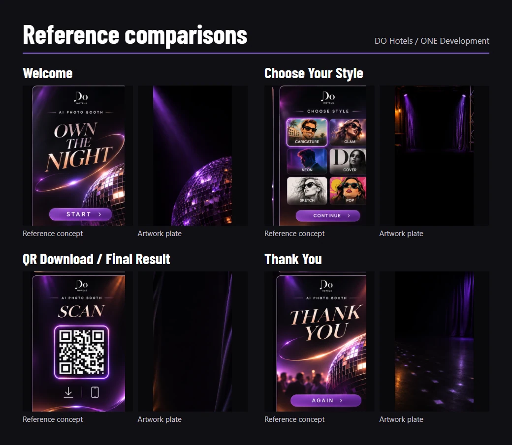
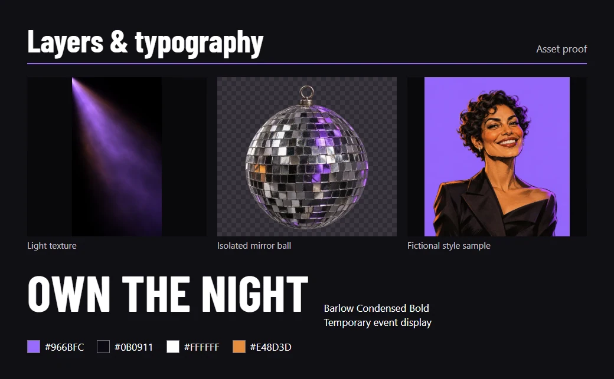

# Step 02 · Visual asset QA

**Library ready for layout work.** Seven separate image masters, two WebP delivery sizes per master, seven proof thumbnails, a local display font and a scoped CSS token sheet. The application entry point does not import the library. The references remain internal comparison material.

## Reference and asset comparisons

| Reference under `brief/references/approved-screens/` | Artwork decision |
| --- | --- |
| `01_welcome.png` | The large cropped mirror ball anchors the lower right. One diagonal violet beam leaves space for a live headline. Silver tiles carry small warm reflections. |
| `02_choose-style.png` | Paired stage lights and side curtains hold the card area open. The only example portrait in the library depicts the approved Caricature style. |
| `06_result.png` and `07_qr.png` | The shared velvet plate keeps its light at the perimeter so a separately composed portrait or an opaque white QR panel can occupy the middle. The QR comparison is shown above. |
| `08_thank-you.png` | Violet and amber floor reflections give the farewell its own ending composition. The open middle takes a short headline. |

Also inspected Camera, Countdown, Processing and Error concepts, both party mood boards, and the historical twelve-screen preview. Their lighting and chrome informed the reusable layers. The nine-state scope is unchanged.

## Files and delivery

The [asset manifest](../public/artwork/manifest.json) records each image's use, native dimensions, byte size, transparency, public URL and all three derivatives. A URL beginning with `/artwork/` maps to `public/artwork/` on disk. Masters are PNGs. Full-size and compact WebPs are in `web/`. Proof images are in `proofs/`.

| ID | Native pixels | Intended use |
| --- | ---: | --- |
| `welcome-club` | 941 × 1672 | Full-bleed attract plate |
| `style-stage` | 941 × 1672 | Alternate stage with clear center |
| `spotlight` | 941 × 1672 | Opaque light texture on black. Screen blend when layered. |
| `mirror-ball` | 1254 × 1254 | Isolated prop with true alpha, including the suspension eyelet |
| `result-ground` | 941 × 1672 | Quiet background for result and handset QR presentation |
| `thank-you-vignette` | 941 × 1672 | Closing dance-floor reflections |
| `caricature-sample` | 1195 × 1316 | Fictional adult illustration, framed above the hands. Preserve the headroom and full silhouette when fitting a card. |

All seven full-size WebPs total **900,644 bytes**. The 540 px compact set totals **185,656 bytes** and the 192 px proof set **33,686 bytes**. A separate decode verified all 28 files against their manifest dimensions, formats/paths, recorded sizes and transparency. The mirror ball has alpha from 0 through 255 in all four files. The remaining artwork is opaque.

The photographic plates are close to 9:16 and require about 15% enlargement at the provisional 1080 × 1920 stage. Full-size variants preserve native resolution. At one background pixel in the sample illustration, the measured RGB was 147/103/251. Use the `#966BFC` token when compositing the actual guest export in its later step.

## Identity and type

- **ONE.** Use an approved purple-on-white or white-on-purple lockup, with the authorized monochrome variants when needed. Keep the clearance illustrated with half the original O on page 13. Pages 16–17 cover color choice and misuse, page 24 gives `#966BFC`, and page 28 specifies Sharp Sans Display No2 Bold and Medium. [ONE manual](../brief/references/brand/ONE_DEVELOPMENT_Brand_Manual.pdf)
- **DO.** Select the supplied black or reversed white logo variation for the chosen background. Preserve the X clearance from page 8 on all sides. Black and white are primary, and warm orange RGB 228/141/61 is available for small lighting accents. The manual specifies Alexandria for English and DIN Next LT Arabic for Arabic. See pages 7–13 and 15. [DO manual](../brief/references/brand/DO_Hotels_Brand_Manual.pdf)
- **PENDING.** The library has no approved ONE/DO vector masters, signed-off co-brand placement or licensed Sharp Sans/Alexandria files. The stage header is a layout reservation only. Apply the clearance around each actual master when supplied. Lighting, tint and blend effects belong to scene layers.
- **Temporary event type.** Self-hosted Barlow Condensed Bold supplies the headline and action roles, with system sans for body text. The original TTF and its SIL Open Font License 1.1 ship together. [License](../public/fonts/barlow-condensed/OFL.txt) · [Pinned upstream source](https://github.com/google/fonts/tree/60824dce48f7dd28fe7d65559f2da1f6e04e585b/ofl/barlowcondensed)

## Stage and legibility checks

[Design tokens](../src/design/tokens.css) scope the palette, type roles, safe area and grid to `.booth-stage`. At the reference size, the side gutters are 72 px, top inset 96 px and bottom inset 120 px. Header and action rows reserve 180 and 216 px. These are proposed event layout values. Type scales with stage width, with minimum sizes for narrow previews. The stage retains its portrait ratio in landscape.

| Edge viewport | Measured stage | Side gutter | Hero type |
| --- | --- | ---: | ---: |
| 1080 × 1920 | 1080 × 1920 | 72 px | 144 px |
| 390 × 844 | 390 × 693.3 | 26 px | 52 px |
| 1440 × 900 | 506.25 × 900 | 33.75 px | 67.5 px |

An isolated browser fixture loaded the local font and token sheet at all three sizes. A luminance check in the center of each stage plate (25–75% across, 25–66% down) measured white contrast against the 95th-percentile background luminance. Welcome measured 10.2:1, style 20.5:1, result/QR 20.3:1 and farewell 19.3:1. These are composition checks. Final text placement, physical display brightness, QR quiet zone and phone scanning still need validation with the integrated screens and event hardware.

## Generation and scope

Each artwork was generated separately with the built-in Codex image tool. Its interface did not expose a selectable or verifiable Sunburst/Flare model ID. No external paid image API, guest photos or legacy project assets were used. Logo variants, text controls and actual QR codes remain separate from the image pixels. No screens were implemented in this checkpoint.
